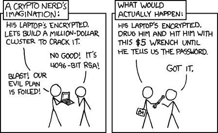

## Anahtar Güvenliği

### Tarihten Anahtar Güvenliği 

**Project Venona**

OTP (one time pad) güvenlij anahtarı bir insan tarafından zar atılarak oluşturulmuştur.
Ama anahtarın zor oluşturulması nedeniyle aynı anahtarla bir çok şey şifrelenmiştir.
1943 yılında ABD Silahlı Kuvvetleri Özel Şifre Servisi (daha sonra NSA) tarafından yürütülen bir proje ile Sovyetler Birliği'nin dış istihbarat servislerinin kurduğu şifreli telgraf iletişiminde bir çok mesaj çözülmüştür.

- ABD devlet kurumlarına, ordusuna ve Manhattan Projesi'ne (atom bombası geliştirme programı) sızmış yüzlerce Sovyet ajanının kimliği tespit edildi.

- Julius ve Ethel Rosenberg (ABD atom sırlarını Sovyetlere satan çift) ile "Beş Cambridge Ajanı" olarak bilinen ünlü İngiliz casus ağı bu mesajlar sayesinde ortaya çıkarıldı.

So

### XKCD Anahtar güvenliği

[XKCD Security 538](https://xkcd.com/538/)

