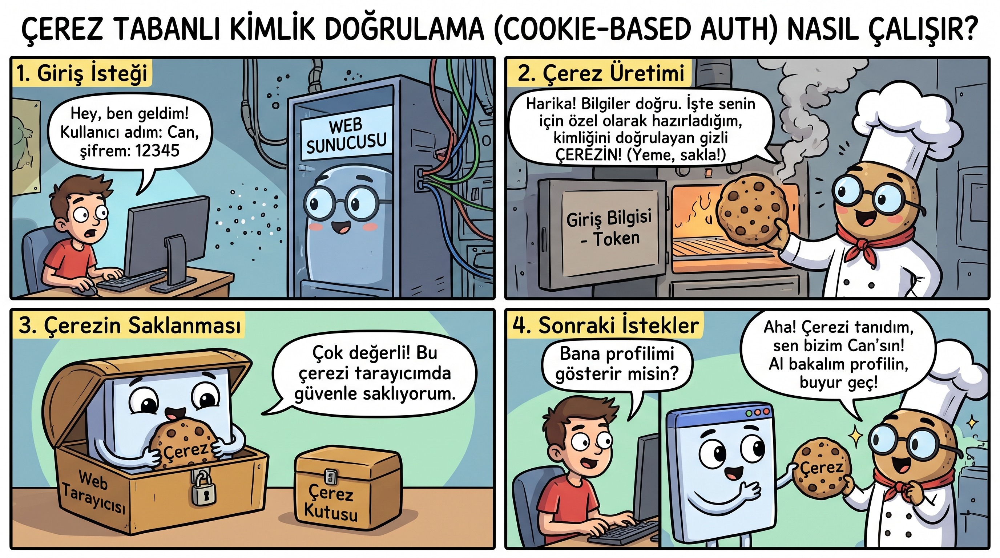
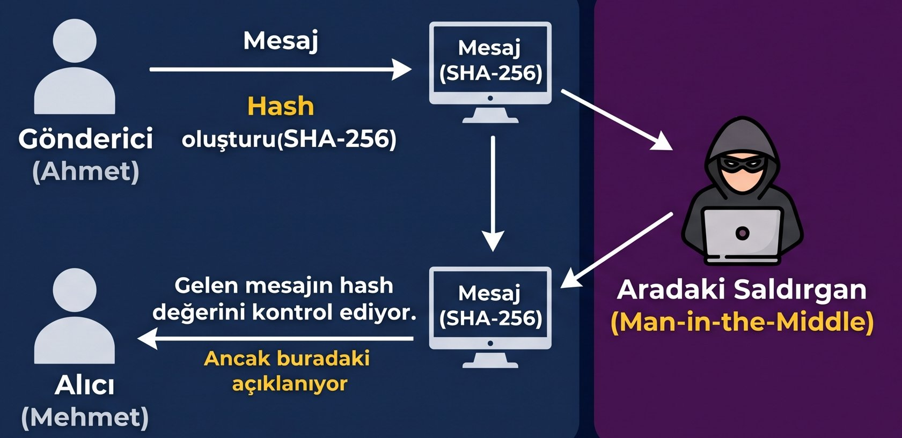

# MAC: İleti Kimlik doğrulama kodları 

MAC (Message authentication codes) türkçe olarak İleti Kimlik doğrulama kodu olarak çevrilmiştir.
MAC bir mesajın **bozulmadığını (integrity)** ve **kaynağının doğruluğunu (authenticity)** garanti etmek için kullanılan simetrik kriptografik bir tekniktir.
MAC mesaj gizliliğini garanti etmez.

## Web Sunucu Çerez Kimlik Doğrulama

Kimlik doğrulamaya ihtiyaç için geleneksel olarak web sunucu çerez örneği gösterilir.

## Bilişim Terimleri Sözlüğü Terimler

-  message authentication code ileti kimlik
doğrulama kodu
- hashing (özetlemleme)
- hash-based message authentication code
algorithm (özetlem tabanlı ileti kimlik
doğrulama kodu algoritması)
- authentication code (doğrulama kodu)

## Temel Çalışma Mantığı (Özet)

$$\text{MAC} = \text{MAC-Algoritması}(K, M)$$

* **$K$**: Gönderici ve alıcı arasındaki paylaşılan gizli anahtar
* **$M$**: Doğrulanacak veri / mesaj

## İş Akışı



1. Gönderici ve alıcı önceden paylaştıkları **gizli bir anahtara (secret key)** sahiptir. 
2. Gönderici, mesaj ve bu gizli anahtarı birleştirerek sabit uzunlukta bir "etiket" (MAC değeri) oluşturur. 
3. Alıcı mesajı aldığında aynı anahtarla etiketi yeniden hesaplar; eşleşme sağlarsa mesajın yolda değiştirilmediğini ve gerçekten belirtilen göndericiden geldiğini doğrular.

3. Sadece kriptografik bir Hash fonksiyonu (örneğin SHA-256) kullanmak mesaj bütünlüğünü sağlar ancak **kimlik doğrulaması (authentication) sağlayamaz**. 
Çünkü ortadaki bir saldırgan (Man-in-the-Middle) hem mesajı hem de mesajın Hash değerini değiştirip alıcıya gönderebilir. 
Alıcı Hash'i doğrulasa bile mesajın kimden geldiğini anlayamaz.
Bu noktada **MAC** özetleme (hash) sürecine gizli anahtar ekler.



## MAC vs. Kriptografik Hash Karşılaştırması



## HMAC (Hash-based MAC)

Hashing algoritması (MD5, SHA-1, SHA-256 vb.) ile gizli bir anahtarın özel yapılandırılmış iki aşamalı (inner/outer padding) bir kombinasyonudur.
Günümüzde en yaygın kullanılan MAC yapılarından biridir.
	- TLS/SSL
	- IPsec
	- OAuth

## CBC-MAC / CMAC

Hash fonksiyonu yerine blok şifreleme (AES gibi) algoritmalarını kullanarak MAC etiketleri üretir.

